<div align="center">

# Footnote

**What IPOs bury in the fine print, with the page to prove it.**

An Indian IPO offer document (DRHP, RHP or prospectus) runs 300 to 800 pages. Who owns the
company, which family firms it trades with, who its bankers are, and which cases it is
fighting are all disclosed — scattered across sections almost nobody reads.

Footnote reads the filing, maps **who is connected to the company and where the money
goes**, runs fixed checks over what it finds, and links every line to the page of the PDF
it came from, with the quote highlighted.

<p>
  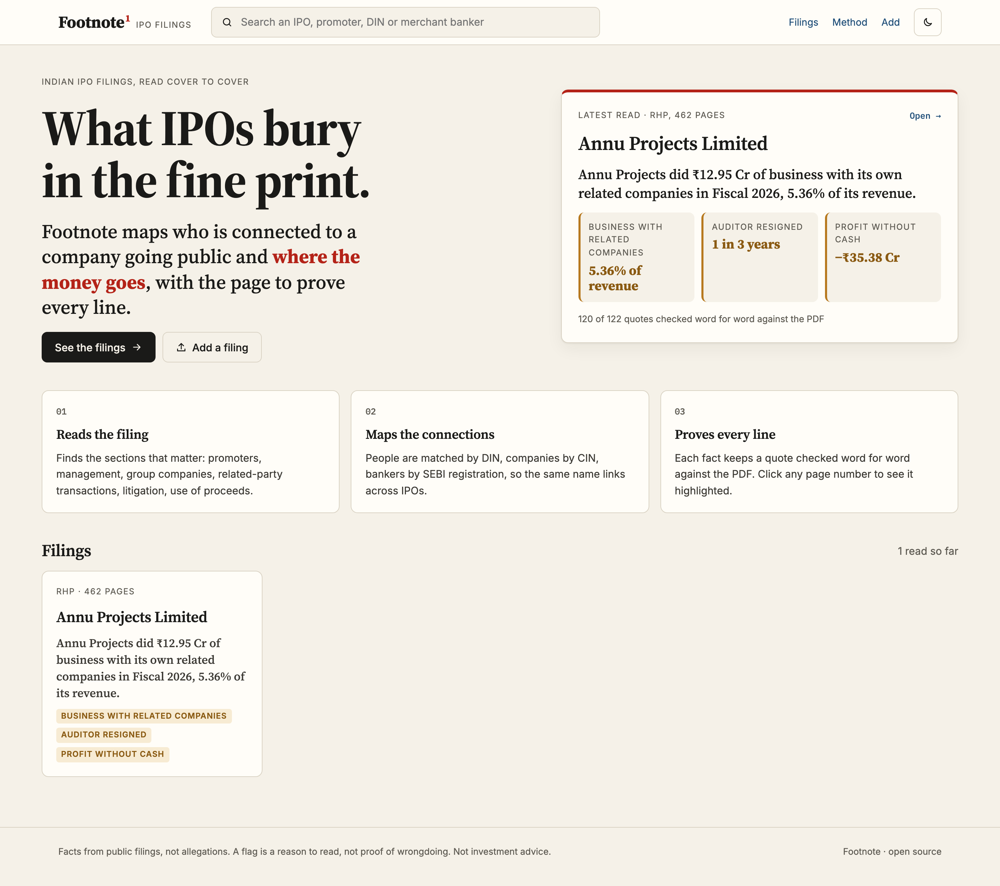
</p>

<p>
  <a href="LICENSE"></a>
  <a href="https://github.com/prutxvi/GraphMind/actions/workflows/ci.yml"></a>
  
  
  
  
  
  
</p>

</div>

---

## ✨ What you get for each filing

| | |
|---|---|
| 🗞️ **A one-line headline** | Written from the strongest finding, not a summary. *"Annu Projects did ₹12.95 Cr of business with its own related companies in Fiscal 2026, 5.36% of its revenue."* |
| 🚩 **Red flags from fixed rules** | Related-party business as a share of revenue, money lent to related parties, IPO money going to related parties, auditor resignations, pending criminal or regulatory cases, the lead manager's record, and profit without operating cash. **No model decides what is suspicious.** |
| 🕸️ **A connection map** | Promoters and directors on the left, group and related companies on the right, bankers and auditors on top, the company in the centre. Money is drawn in red with thickness by amount; salaries and sitting fees are thin grey *pay* lines. Deterministic layout, not a force blob. |
| 📄 **The source, always** | Click any flag, line, box or page number and the real PDF page opens with the quote highlighted. Every quote is checked word for word against its page; anything not found is marked **unverified** and never silently trusted. |
| 🔗 **People and companies across IPOs** | People link only by **DIN**, companies by **CIN**, **SEBI registration** or name — so "everywhere this banker appears" is one click, and names that collide do not merge. |
| 💬 **Questions with citations** | Answers use only the filing and cite `S1 · p.73`-style sources. Retrieval is TF-IDF over the filing's own facts and pages — no embedding API, no vector database. |
| 🌗 **Paper-and-ink UI** | An investigative report, not a hacker terminal: serif headlines, paper surfaces, red only where money or risk is involved, dark mode, and a layout that works on a phone. |

## 📸 Screenshots

| Home — the latest filing read, its headline and its flags | The filing page — headline, flags, connection map, source panel |
|---|---|
|  | 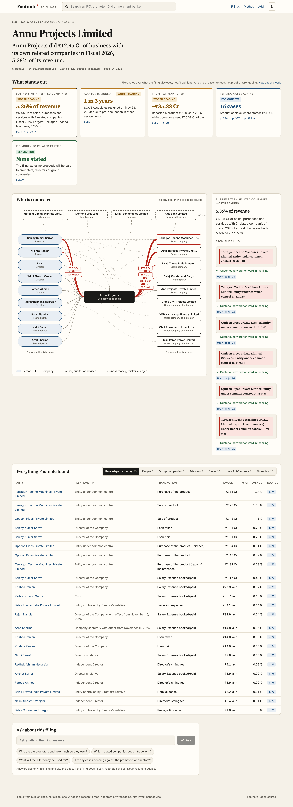 |

| Who is connected — deterministic map, red for business money | What stands out — one card per rule, with the page |
|---|---|
| 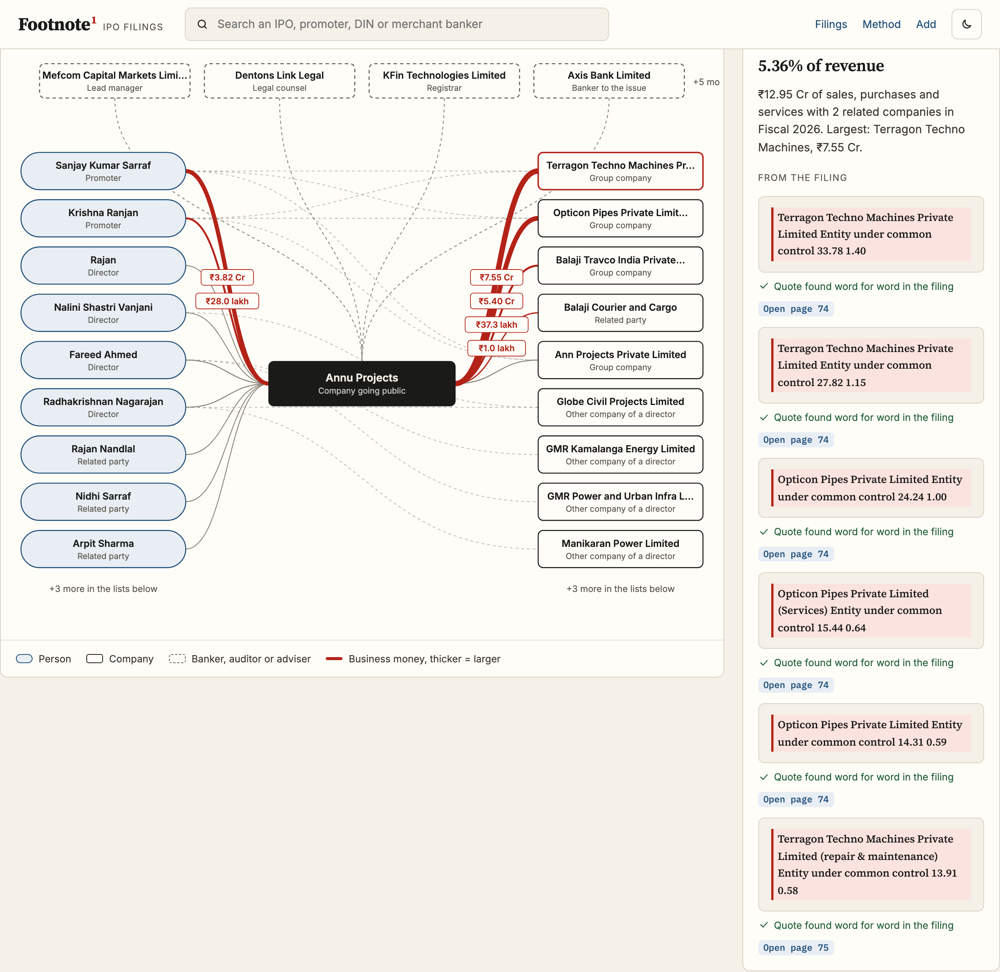 | 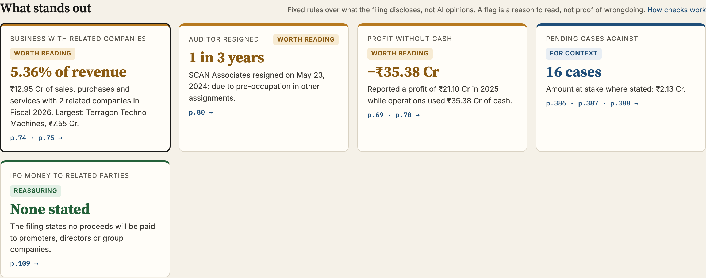 |

| Everything Footnote found — related-party money, people, advisers, cases | The source — real PDF page 74, quote highlighted |
|---|---|
| 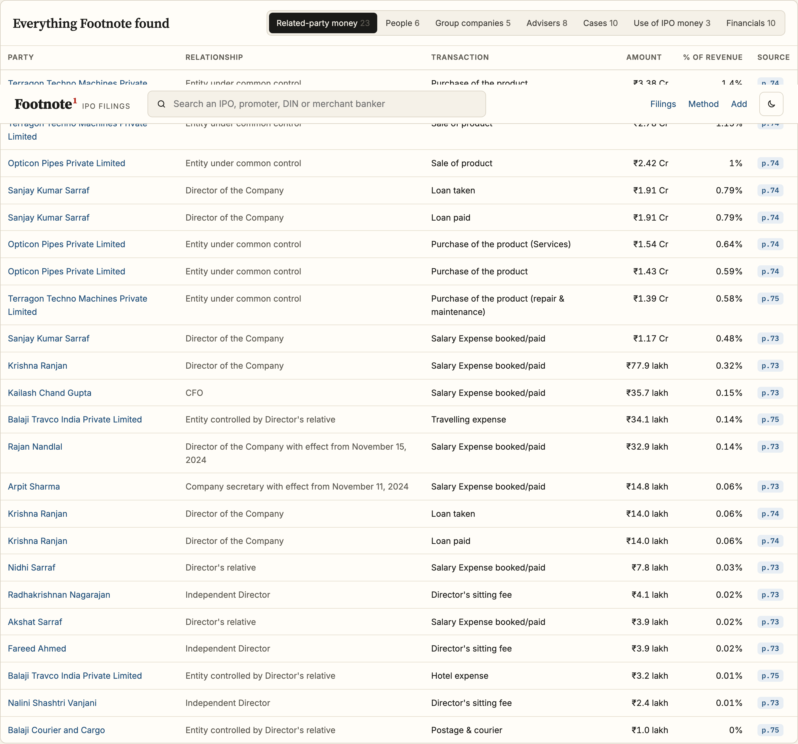 | 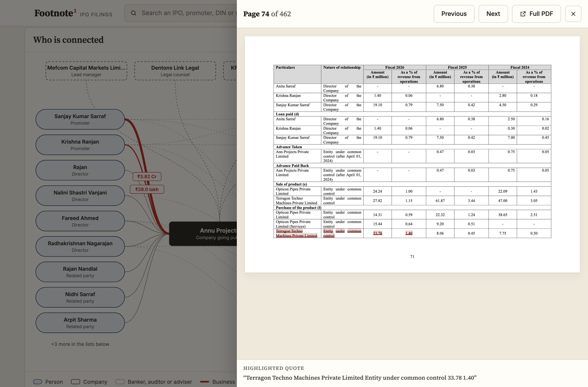 |

| A person across filings, matched by DIN | Method — how it reads, extracts, links and checks |
|---|---|
| 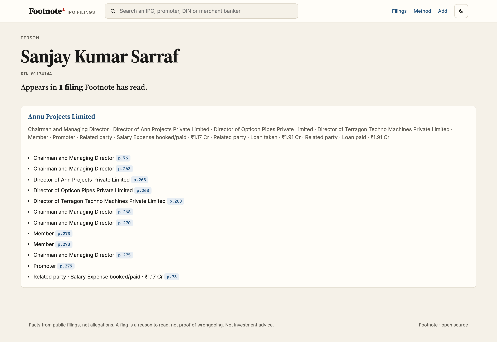 | 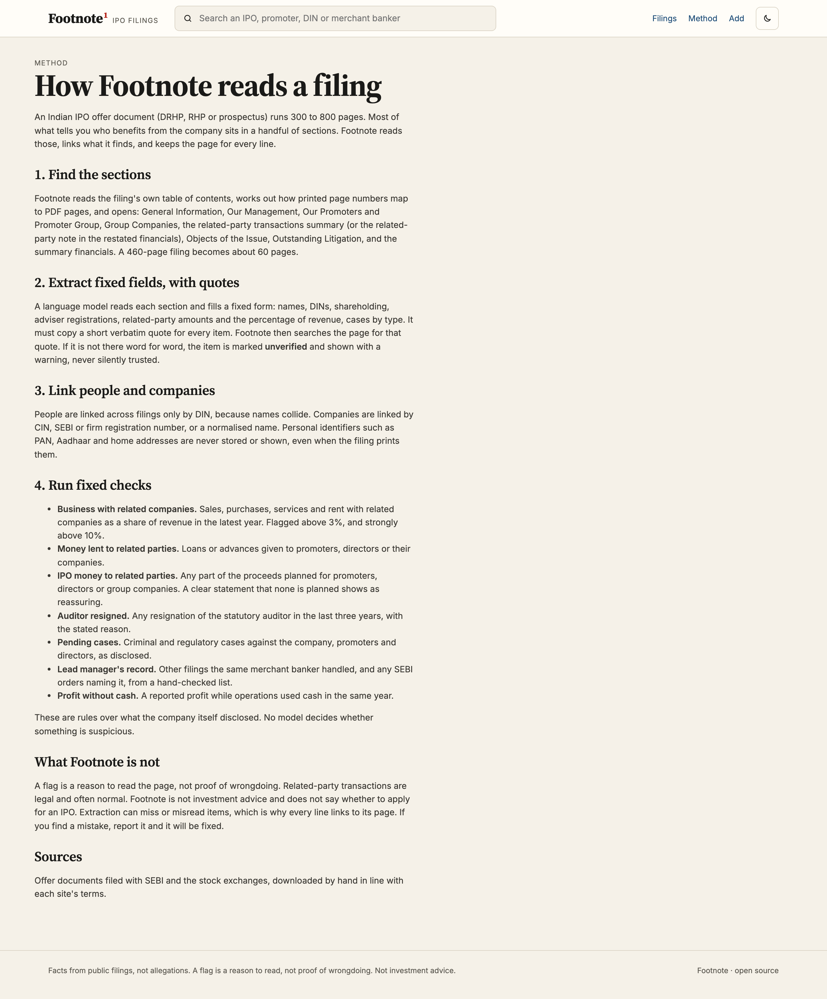 |

| Add a filing — drag and drop, live steps, live counters | Dark mode |
|---|---|
| 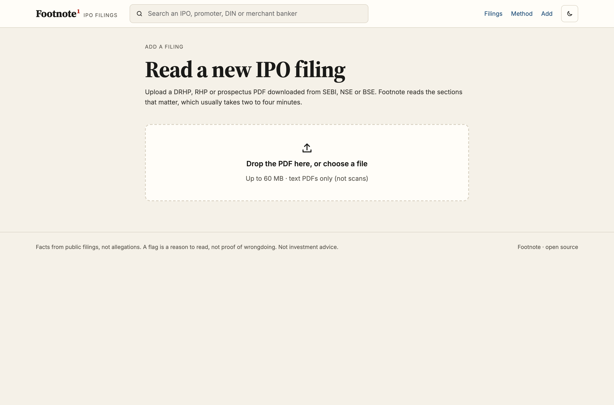 | 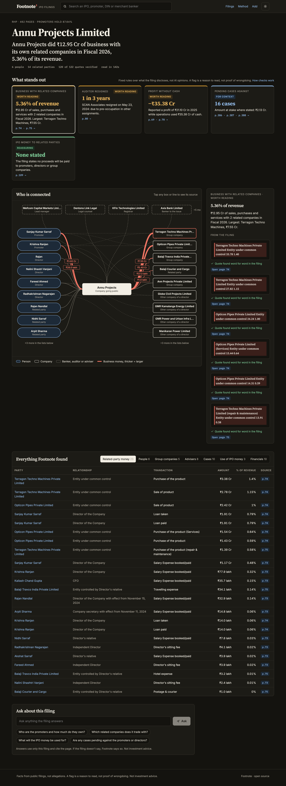 |

| Phone — home | Phone — filing |
|---|---|
| 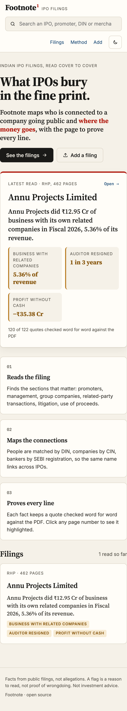 |  |

## 📈 A real filing, end to end

The first run on a real offer document, 22 Oct 2026: **Annu Projects Limited**, Red Herring
Prospectus dated 18 Aug 2026, **462 pages**, mainboard, from SEBI's site.

| | |
|---|---|
| Sections found from the filing's own table of contents | **9 of 9** (page offset 3) |
| Model calls | **22** (about 40K input tokens) |
| Wall-clock time | **2 min 22 s** |
| Facts extracted | **122** |
| Facts whose quote was found word for word on the page | **120 (98.4%)** |
| Connection map | **34 nodes, 55 edges** |
| Tests | **16 passing in 0.5 s**, no network and no API key |

### What it flagged

| Flag | Severity | Finding |
|---|---|---|
| Business with related companies | Worth reading | **5.36% of revenue** — ₹12.95 Cr of sales, purchases and services with 2 related companies in FY26. Largest: Terragon Techno Machines, ₹7.55 Cr. |
| Profit without cash | Worth reading | **₹21.10 Cr profit in FY25 while operations used ₹35.38 Cr of cash.** |
| Auditor resigned | Worth reading | SCAN Associates resigned on 23 May 2024, "pre-occupation in other assignments". |
| Pending cases | For context | **16 cases** against the company, promoters and directors (₹2.13 Cr at stake where stated), mostly tax. |
| IPO money to related parties | Reassuring | The filing states no proceeds will be paid to promoters, directors or group companies. |

### Accuracy check against pages read by hand

| Item | Footnote | ✓ |
|---|---|---|
| Promoters | Sanjay Kumar Sarraf and Krishna Ranjan, together **87.64%** | ✅ |
| Directors' DINs | 01174144, 01265320, 03370404, 00996242, 09698462, 00701892 | ✅ all six |
| Lead manager | Mefcom Capital Markets, INM000000016 | ✅ |
| Registrar, legal counsel, syndicate | KFin (INR000000221), Dentons Link Legal, Mefcom Securities | ✅ |
| Auditor change | SCAN Associates resigned 23 May 2024 | ✅ |
| Group companies | Opticon Pipes, Terragon Techno Machines, Balaji Travco, Ann Projects | ✅ |
| FY26 related-party amounts | ₹33.78 M, 27.82 M, 24.24 M, 15.44 M, 14.31 M | ✅ to the decimal |
| Use of IPO money | Capex ₹15.41 Cr, working capital ₹115 Cr, GCP to be decided | ✅ |

The full write-up, including the seven bugs the run exposed and their fixes, is in
[docs/real-filing-test.md](docs/real-filing-test.md).

## 🧱 Tech stack

| Layer | Choice | Why |
|---|---|---|
| PDF text and TOC | `pypdf` | Pure Python, no system libraries, works on Railway. |
| Extraction | Any OpenAI-compatible endpoint (`openai` SDK) | Fixed-field prompts per section, ~9,000-character chunks, 4 in parallel, JSON repair, amount units in lakh / million / crore. |
| Verification | `ingest.Normaliser.verify()` | Every quote is re-found on its page; failures are labelled, not dropped. |
| Storage | SQLite (`store.py`) | One file, no server. Tables for filings, pages, entities, entity keys, facts and raw extractions. |
| Rules | `report.py` | Thresholds in `config.py`; a flag is a rule over cited facts, never a model opinion. |
| Retrieval | TF-IDF (`retrieve.py`) | No embedding API and no vector database to run or pay for. |
| API | FastAPI + uvicorn | Uploads run in a background thread with live progress. |
| UI | React 19 + Vite 7, no UI framework | 15 source files, a 28-line History router, tokens in one CSS file. |
| PDF viewer | pdf.js 4.10, lazy-loaded | Main bundle stays at **238 kB**; the viewer chunk (338 kB) loads only when a page is opened. |
| Redaction | `ingest.redact()` | PAN, Aadhaar and home addresses are scrubbed before anything is stored. |

## 🚀 Quickstart

Needs **Python 3.10+** and **Node 20+**.

```bash
# 1. Backend
cd backend
python -m venv .venv && source .venv/bin/activate
pip install -r requirements-dev.txt
cp .env.example .env                 # set LLM_API_KEY (any OpenAI-compatible endpoint)
uvicorn main:app --reload            # http://127.0.0.1:8000/docs

# 2. Frontend, second terminal
cd frontend
npm install
npm run dev                          # http://localhost:5173 (proxies /api to :8000)
```

Add filings from the **Add** page, or in bulk from the command line:

```bash
cd backend
python -m footnote.ingest ~/Downloads/filings/*.pdf       # read a folder
python -m footnote.ingest --relink <filing-id>            # re-run rules and matching, no model calls
```

Download filings by hand from SEBI, NSE Emerge or BSE SME. **NSE's terms prohibit automated
collection**, so Footnote never scrapes them.

### The lead-manager check

It reads `data/sebi_orders.json`, a hand-checked list. Copy
`data/sebi_orders.example.json`, add one entry per SEBI order with its URL, and the flag
appears on every filing that banker handled. It is empty today, so that check cannot fire yet.

### Tests

```bash
cd backend && pytest
```

The suite builds offer documents as real PDFs and runs the whole pipeline on a `FakeLLM`, so
it needs no network and no key. It covers table-of-contents parsing and the page offset,
amount units, quote verification, PAN redaction, DIN-based matching, every flag rule,
cross-filing links, and the API. CI additionally runs the frontend lint and build, on Python
3.10 and 3.12.

## 📁 Project structure

```
GraphMind/                        (repo rename to footnote pending)
├── backend/
│   ├── main.py                   FastAPI app, API routes, SPA and PDF serving
│   ├── footnote/
│   │   ├── config.py             settings and flag thresholds from env
│   │   ├── llm.py                OpenAI-compatible client, session header,  thinking strip
│   │   ├── pdftext.py            page text, TOC parsing, printed→PDF page offset, sections
│   │   ├── extract.py            per-section prompt specs, chunk jobs, parallel run
│   │   ├── ingest.py             Ingestor, Normaliser, verify(), redact(), relink(), CLI
│   │   ├── store.py              SQLite schema and name normalisation
│   │   ├── report.py             flags, headline, graph, lists, entity_report()
│   │   ├── chat.py               per-filing TF-IDF indexes, numbered sources, citations
│   │   └── retrieve.py           small TF-IDF index, no embedding API
│   ├── tests/                    16 tests on hand-built PDFs and a FakeLLM
│   ├── requirements.txt          runtime pins
│   └── requirements-dev.txt      + pytest, httpx
├── frontend/
│   └── src/
│       ├── App.jsx               shell, search, theme, lazy PDF viewer
│       ├── nav.js, router.jsx    28-line History router
│       ├── MapView.jsx           deterministic connection map
│       ├── PdfViewer.jsx         pdf.js + quote highlighting
│       ├── pages/                Home, Filing, Entity, Add, Method
│       └── styles.css            design tokens, light and dark
├── data/
│   ├── sebi_orders.example.json  format for the hand-checked order list
│   └── filings/                  local PDFs (git-ignored)
├── screenshots/                  the images above, captured from the running app
├── docs/
│   ├── real-filing-test.md       the Annu Projects run, checked by hand
│   ├── red-flag-rules.md         every rule, its threshold and its severity
│   ├── data-model.md             SQLite tables, fact kinds, DIN/CIN matching
│   └── architecture.md           pipeline, module map, API, deploy shape
├── .github/workflows/ci.yml      backend tests + frontend lint and build
├── railway.json, nixpacks.toml   one-service deploy
└── LICENSE, CONTRIBUTING.md, CHANGELOG.md, THIRD-PARTY-NOTICES.md
```

## 🔌 API

| Method | Path | What |
|---|---|---|
| GET | `/api/health` | version, whether an LLM is configured, whether uploads are allowed |
| GET | `/api/filings` | cards: company, headline, flag summary |
| GET | `/api/filings/{id}` | the full report: flags, graph, lists |
| GET | `/api/filings/{id}/status` | live ingest progress |
| GET | `/api/filings/{id}/pdf`, `/pages/{n}` | the PDF itself, and the text of one page |
| POST | `/api/filings` | upload; ingest runs in a background thread |
| POST | `/api/filings/{id}/chat` | a cited answer about that filing |
| GET | `/api/entities/{id}` | everywhere a person or company appears |
| GET | `/api/search?q=` | filings and entities by name, DIN, CIN or registration |

## ⚖️ Limits, and what this is not

- **Extraction can miss or misread items.** That is why every line links to its page and
  unverified quotes are labelled. Read the page before you believe the line.
- **A flag is a reason to read, not proof of wrongdoing.** Related-party transactions are
  legal and often ordinary. Footnote describes what the company disclosed.
- **Not investment advice.**
- Scanned (image-only) PDFs need OCR first.
- People without a DIN in the filing are **deliberately not linked** across filings, because
  names collide. On Annu Projects, "Rajan" (a director, with a DIN) and "Rajan Nandlal" (paid
  a salary, no DIN) are probably the same person and are kept apart on purpose.
- 2 of the 122 facts on the real run are unverified: the model stitched separate lines
  together, and Footnote says so instead of hiding it.
- The current LLM is a shared low-cost endpoint; switch to a pay-as-you-go provider before
  any public deployment.

## 🛡️ Privacy

Filing PDFs are public documents, but they print PAN, Aadhaar and home addresses. Footnote
scrubs those before anything is stored. Uploads are off by default on a public deployment
(`ALLOW_UPLOADS=0`), which serves only filings already read.

## 🚀 Deploy

One service: Vite builds into `backend/static` and FastAPI serves both. `railway.json` and
`nixpacks.toml` (Node 20 + Python 3.12) are included.

```bash
cd frontend && npm run build          # writes into backend/static
cd ../backend && uvicorn main:app     # serves API, UI and PDFs
```

Set `LLM_API_KEY` to allow uploads and questions, and `ALLOW_UPLOADS=0` to keep the public
site read-only.

## 🗺️ Roadmap

- [ ] Rename the GitHub repo `GraphMind` → `footnote`, push this branch
- [ ] Populate `data/sebi_orders.json` so the lead-manager check fires
- [ ] Test the 3 SEBI-acted SME filings (Synoptics, Varyaa, Nirman Agri) — the launch story
- [ ] Switch the LLM to a pay-as-you-go provider
- [ ] Deploy the read-only instance

## 🤝 Contributing

See [CONTRIBUTING.md](CONTRIBUTING.md). Run `pytest` in `backend/` and `npm run lint` in
`frontend/` before opening a pull request.

## 📄 License

MIT © 2026 Toganti Pruthvi Raj — see [LICENSE](LICENSE). Third-party licences, including the
fonts and pdf.js, are listed in [THIRD-PARTY-NOTICES.md](THIRD-PARTY-NOTICES.md).

---

<div align="center">
<sub>Facts from public filings, not allegations. A flag is a reason to read, not proof of wrongdoing. Not investment advice.</sub>
</div>
